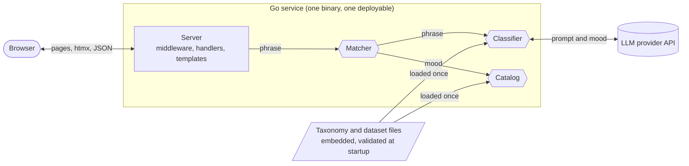
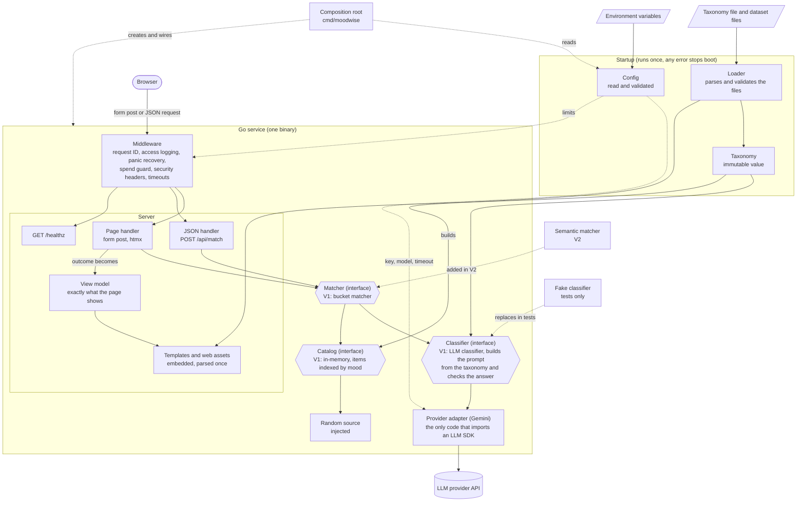
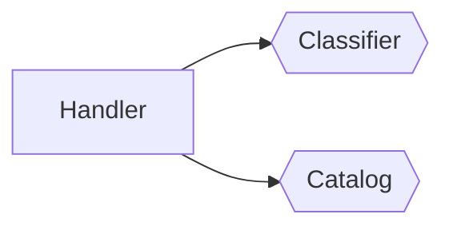
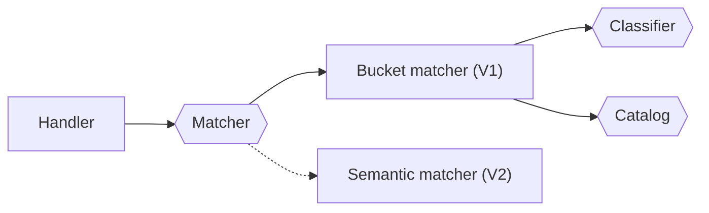

# V1 architecture diagrams

Diagrams for the TDD's "Architecture and components" section.

## High level

The whole V1 design in one glance. The complete diagram below opens up each box.

In words: the browser talks only to the server. The server hands the phrase to the `Matcher`. The matcher asks the `Classifier` for a mood, which is the only step that leaves the service, and then asks the `Catalog` for items in that mood. The data files are read once at startup.

## Complete architecture

How to read it:
- Solid arrows mean "calls" or "uses". Dotted arrows are wiring, configuration, or something that replaces a component in tests or a later version.
- Hexagons are interfaces. The implementation V1 uses is named inside the hexagon.
- Responses travel back along the same path the request took.

What the diagram shows:
- **The handler knows one thing downstream:** the `Matcher`. It never touches the `Classifier` or the `Catalog`, which is the decision recorded in the TDD.
- **Only the provider adapter reaches the outside world,** and only it imports an LLM SDK.
- **The taxonomy is loaded once** by the loader and handed to the three consumers: the classifier, the templates, and the loader itself (which checks every dataset tag against it).
- **The composition root is the only place that knows the concrete types.** It reads the config, creates the components and wires them together.
- **Dotted nodes are not part of the V1 request path:** the fake classifier replaces the real one in tests, and the semantic matcher arrives in V2 beside the bucket matcher.

## Q2: the handler both ways

Option A, rejected: the handler orchestrates the steps itself.

The handler knows that matching means "get a mood, then look up that mood". V2 matches by embeddings, with no mood in the middle, so the handler would have to be rewritten.

Option B, chosen: the handler calls one `Matcher`.

The handler knows only "phrase in, outcome out". V2 adds a second `Matcher` implementation (dotted) and the handler is untouched.
